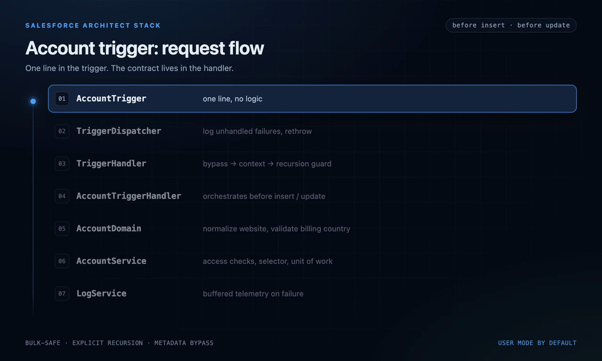

Every Salesforce project I have worked on eventually grows a trigger framework. It starts as a single trigger with an `if` statement, becomes an interface with a dispatcher, and ends with a static `Set<Id>` that someone is afraid to touch. The code is rarely the problem. The problem is the contract: when a handler runs, when it does not, what happens on re-entry, and who is allowed to bypass it.

This article walks through the baseline I built to stop rebuilding that contract on every project. It is deliberately small: 21 production Apex classes, 10 test classes, one trigger, custom metadata for configuration, and a permission set. The interesting parts are the decisions, not the class count.



## The requirements

The framework has to solve the problems that are the same on every org:

- A trigger file contains one line. No logic, no ordering decisions.
- Handlers declare which contexts they care about; everything else is handled once.
- A handler can be disabled or bypassed without a code deployment.
- Recursion has an explicit, testable contract.
- Data access is secure by default, not by review.
- Failures are observable after the debug log is gone.
- A new feature has one obvious place to live.

The non-goal is equally important: this is not a generic ORM or a platform. Salesforce already has an SObject model, validation rules, and permissions. The framework should remove recurring bugs, not replace the platform.

## The options

There are four realistic choices, and the trade-offs are mostly about ownership.

| Option | Strength | Cost |
| --- | --- | --- |
| Logic directly in the trigger | Fastest to write | Ordering, recursion, and duplication spread across every trigger |
| Handler interface plus a dispatcher | Clear entry point and testable units | Bypass, context detection, and recursion are still per-handler decisions |
| A mature third-party framework | Years of edge cases handled | A dependency, a learning curve, and upgrade work you do not control |
| A small owned baseline | Exactly the contract you need | You own the framework and its tests |

I chose the small owned baseline. A third-party framework is often the right answer for a large team with an existing standard, but for a baseline that has to be read and changed by a small team, the extra surface area is a cost. The goal is a framework that fits in a review, not one that needs a training course.

## One line, then a contract

The trigger is intentionally boring:

```apex
trigger AccountTrigger on Account (before insert, before update) {
    TriggerDispatcher.run(new AccountTriggerHandler());
}
```

The dispatcher has one job: run the handler, log unhandled failures with the handler name, and rethrow. Swallowing an exception would commit a partially applied transaction, which is worse than failing.

The lifecycle lives in `TriggerHandler.run()`. The order matters:

1. Check the bypass layers.
2. Confirm the code is actually inside a trigger.
3. Resolve the context.
4. Verify the handler serves this SObject.
5. Check the recursion guard.
6. Mark the records as handled.
7. Call the context hook.

That order is the contract. The bypass check happens first so an operator can stop a misbehaving handler even when the data is bad. The `Trigger.isExecuting` check is before context resolution because `Trigger.new`, `Trigger.old`, and the context flags are null outside a trigger. A handler invoked directly from a test or a service should fail with a clear configuration error, not a null pointer.

A distilled version:

```apex
public void run() {
    if (TriggerControl.isBypassed(getHandlerName())) {
        return;
    }
    if (!Trigger.isExecuting) {
        throw AppException.configuration(
            'TriggerHandler ' + getHandlerName() + ' can only run inside a trigger context.'
        );
    }
    context = resolveContext();
    if (context == null) {
        throw AppException.configuration('Unsupported trigger context.');
    }
    assertSObjectType();

    if (wasHandled()) {
        return;
    }
    markHandled();
    execute();
}
```

The handler subclass only overrides the contexts it needs:

```apex
public with sharing class AccountTriggerHandler extends TriggerHandler {
    public override SObjectType getSObjectType() {
        return Account.SObjectType;
    }

    protected override void beforeInsert() {
        applyDomainRules((List<Account>) getNewRecords());
    }

    protected override void beforeUpdate() {
        applyDomainRules((List<Account>) getNewRecords());
    }

    private void applyDomainRules(List<Account> accounts) {
        AccountDomain domain = new AccountDomain(accounts);
        domain.normalizeWebsite();
        domain.validateBillingCountry();
    }
}
```

If a handler grows past twenty lines, the logic is in the wrong layer. Handlers orchestrate. Domains decide rules. Services compose transactions.

## Recursion is a contract, not a boolean

The usual recursion guard is a static boolean: set it before the work, clear it after, and hope no legitimate second pass needs to run. That breaks in both directions. It blocks a genuine second pass for a different set of records, and it fails when an after-trigger updates the same records and re-enters before the boolean is cleared.

This baseline tracks **which records a named handler has already processed** in the current transaction:

```apex
public static Boolean isHandled(String scope, Set<Id> recordIds) {
    Set<Id> handledIds = HANDLED_IDS_BY_SCOPE.get(scope);
    if (handledIds == null) {
        return false;
    }
    for (Id recordId : recordIds) {
        if (!handledIds.contains(recordId)) {
            return false;
        }
    }
    return true;
}
```

The handler marks records **before** the body runs. A re-entrant DML operation from an after-trigger therefore cannot loop. Records that were not part of the first pass are still processed, because the guard only skips when every record in the current context has already been handled.

The trade-off is explicit: if a handler genuinely needs to reprocess a record in the same transaction, it must do that work directly rather than re-entering the trigger. That constraint is easy to review and easy to test. It is also the kind of rule that should be written down, because the next developer will otherwise assume the framework is being clever.

## Bypass without a deployment

There are three bypass layers, evaluated in order:

1. A runtime bypass registered in the transaction, used by tests and controlled operations.
2. `TriggerSetting__mdt.Is_Active__c = false`, which disables a handler without a code deployment.
3. `TriggerSetting__mdt.Bypass_Custom_Permission__c`, which grants a controlled bypass to an integration user during a data load.

```apex
TriggerSetting__mdt setting = settings().get(handlerName);
if (setting == null) {
    return false;
}
if (setting.Is_Active__c != true) {
    return true;
}
String permissionName = setting.Bypass_Custom_Permission__c;
return String.isNotBlank(permissionName)
    && FeatureManagement.checkPermission(permissionName);
```

The metadata is read once per transaction and cached. That is one SOQL query, not one per handler or per record. The cost is that a metadata change applies on the next transaction, which is the correct semantics for a kill switch. If you need an immediate, in-transaction bypass, use the runtime layer.

## The layers around the trigger

The trigger framework only solves the entry point. The rest of the baseline is about keeping business logic out of it:

| Layer | Rule |
| --- | --- |
| Domain | Business rules over records. No SOQL, no DML. |
| Service | One transactional use case. Composes access checks, selector, domain, unit of work. |
| Selector | Every SOQL query, explicit field list, user mode. |
| Unit of work | Inserts, updates, deletes in a fixed order with savepoint rollback. |

Two details are worth calling out.

**Selectors run in user mode.** Every query goes through `Database.queryWithBinds(..., AccessLevel.USER_MODE)`. That means object and field permissions are enforced by the platform, not by a comment in a review. The trade-off is that a missing permission set now fails visibly, early, instead of silently returning more data than the user should see.

**The unit of work uses a savepoint.** It registers records, then commits inserts, updates, and deletes in a fixed order. Individual DML calls use `allOrNone = false` so every row gets an error message, but the whole unit rolls back if any row fails. That gives predictable all-or-nothing behavior without giving up per-record diagnostics. It does not resolve parent-child relationships; callers insert parents first. Implicit resolution is the feature that makes home-grown units of work impossible to debug.

## What the validation actually caught

Static checks are cheap, and they catch the boring class of failure: malformed XML, a class with no metadata counterpart, a reference to a class that does not exist. A custom parser verifies 32 Apex files and 54 XML files, and CI runs that check on every push.

The compile check is the next step: a check-only deployment to a real org compiled all 54 components with zero component errors. That is a much stronger signal than parsing, because it applies the platform's own compiler and metadata rules.

The test suite is where the useful failures were. Two examples:

- A handler invoked outside a trigger reached `resolveContext()` and dereferenced null trigger flags. The fix was the `Trigger.isExecuting` guard above, which turns a null pointer into a configuration error.
- A scheduled-job test assumed `Test.stopTest()` executes a job scheduled for 2099. It does not. The test now asserts that the job was registered and invokes the schedulable body directly.

The full test run is designed for a scratch org, where the admin permission set is assigned and field access is predictable. The CI job that creates that org is wired but not enabled: it needs a Dev Hub auth secret. Until then, I treat the check-only compile as the compiler gate and the scratch-org run as the acceptance gate. That distinction matters; a successful deployment is not the same as a passing test suite.

## What I would change next

- **Remove assumptions from the test factory.** A factory that sets a default value for every field couples unrelated tests to that field. Tests should override only what they are about; the factory should build the minimum valid record.
- **Make the permission set part of the deploy contract.** User-mode data access is only useful if the runtime users and the test runner have the right field access. The deployment instructions now assign `Architect_Stack_Admin` before tests; that should be enforced by the pipeline, not remembered by a reviewer.
- **Keep the framework small.** Every new hook needs a test and a reason. The moment the framework starts making business decisions, the layering has failed.
- **Use an external sink for audit logs.** Record-based logs are searchable and permissionable, but they roll back with the transaction that produced them. That is documented as a deliberate limitation, not a bug.

## The code

The baseline is at [github.com/aamirahkhan/salesforce-architect-stack](https://github.com/aamirahkhan/salesforce-architect-stack). The README has the deploy sequence, and `docs/` contains the architecture notes and the ADRs behind the trade-offs above.

## Closing

The trigger framework is not the architecture. It is the contract that lets the architecture survive contact with a real org: one entry point, one place for cross-cutting concerns, and explicit rules for the cases that usually become folklore.

If you are rebuilding this, start with the contract: when a handler runs, when it is skipped, and what happens on re-entry. The class diagram is the easy part.
